# Morning Routine — a Mega Drive–style timer for kids

A little browser "game" that is really a **sequenced timer** for a child's morning routine. Each step (shower, getting dressed, breakfast, brushing teeth, shoes) plays a looping pixel-art animation of the same kid, with a shrinking time bar and a big **STOP** button. Press STOP before the time runs out to clear the level!

The look is inspired by 16-bit Sega Mega Drive / Genesis games (cinematic framing, muted rich palettes, smooth animation). All the art is original and drawn in code, so there are no image files.

<p align="center">
  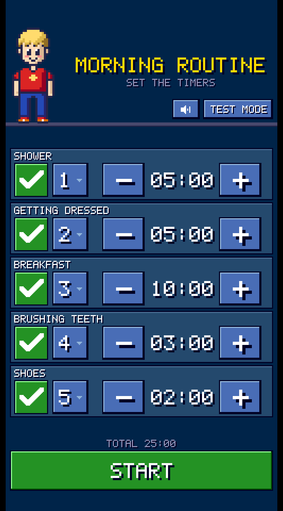
  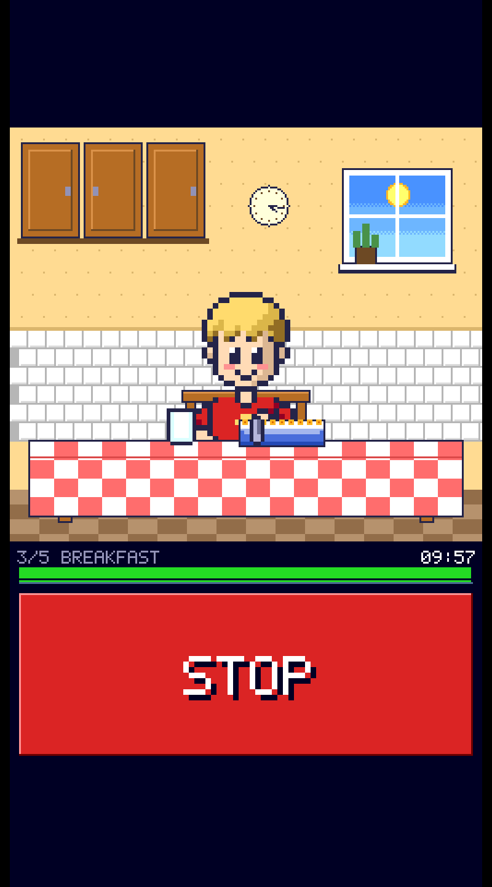
  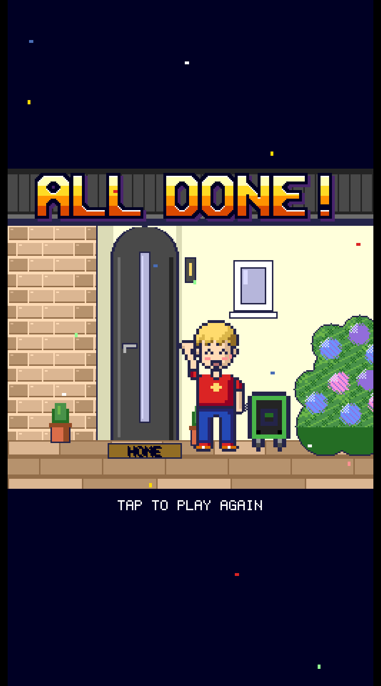
</p>

It is built to run on **very old hardware**: Chrome on Android 4.4 (KitKat), in plain ES5 JavaScript with no frameworks, no build step and no dependencies.

---

## How it works

1. **Set up the morning.** On the options screen, choose the time for each step (30 s to 20 min, in 30 s steps), **tick the scenes** you want and set **their order** with the numbered boxes. Everything is remembered for next time.
2. **Each scene starts with a title card**, then the timer runs. The animation slowly speeds up in the second half.
3. **Sounds:** a soft bell rings when half of the time is gone, a "hurry up" jingle plays when 10% is left, and a "level cleared" tune plays when STOP is pressed.
4. **Red alert:** in the last seconds the whole screen turns red with a gentle pulse, and the kid looks worried.
5. **STOP in time:** GREAT JOB! The kid jumps and claps, then the next scene starts by itself.
6. **Time ran out:** GAME OVER. The kid cries, but CONTINUE moves on to the next scene so the morning is never blocked.
7. **After the last scene:** ALL DONE! The kid waves goodbye in front of the house, with his school bag, lit for the real time of day and weather.

## Screens

| Options | Choose scenes & order | Title card | Red alert |
|:---:|:---:|:---:|:---:|
|  | 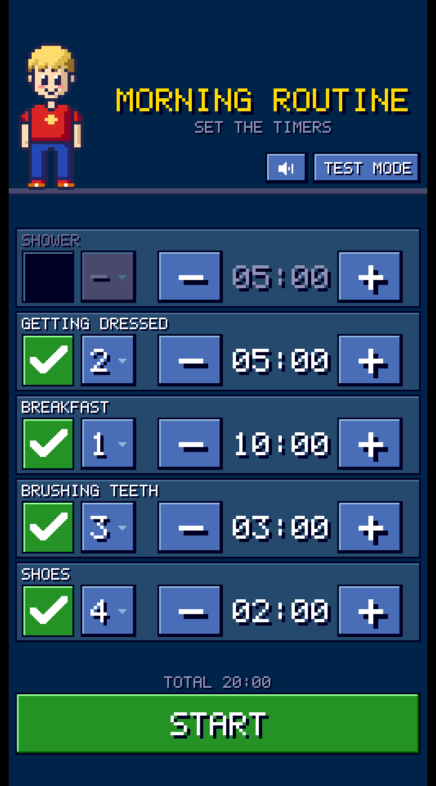 | 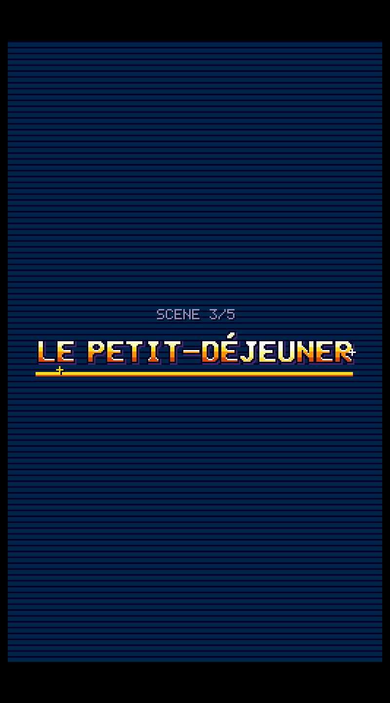 | 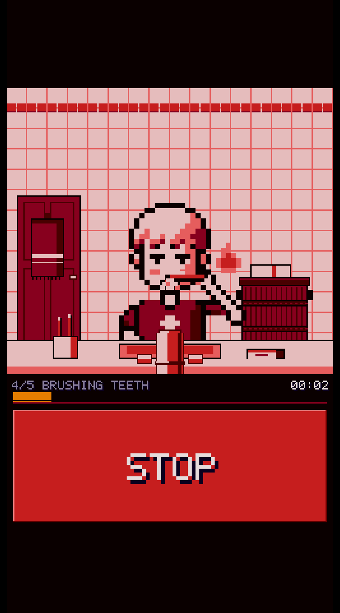 |

| 1. Shower | 2. Getting dressed | 3. Breakfast | 4. Brushing teeth |
|:---:|:---:|:---:|:---:|
| 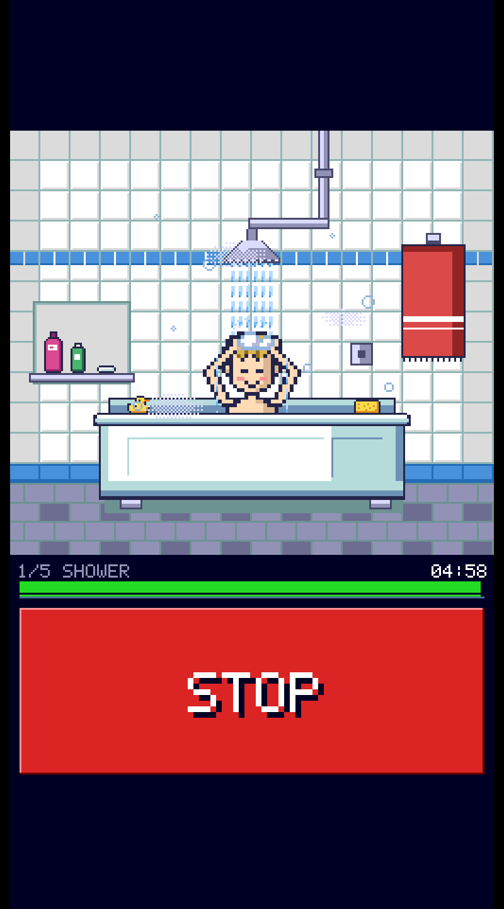 | 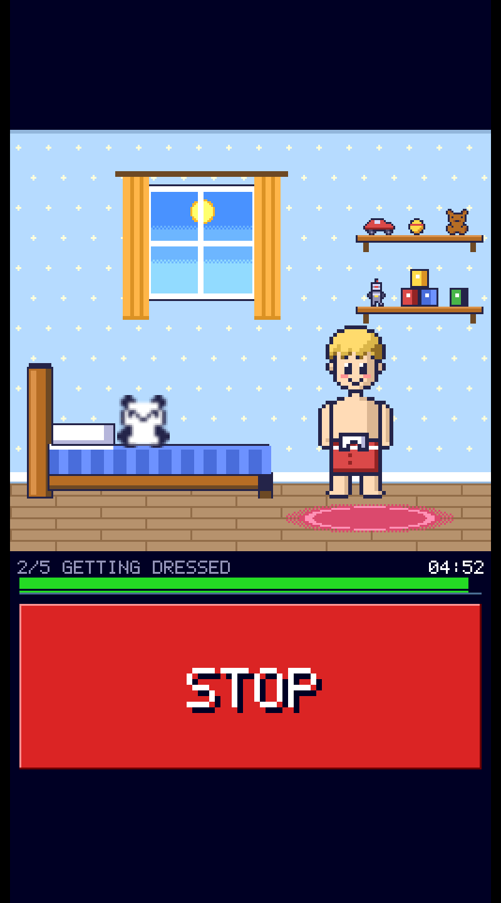 |  | 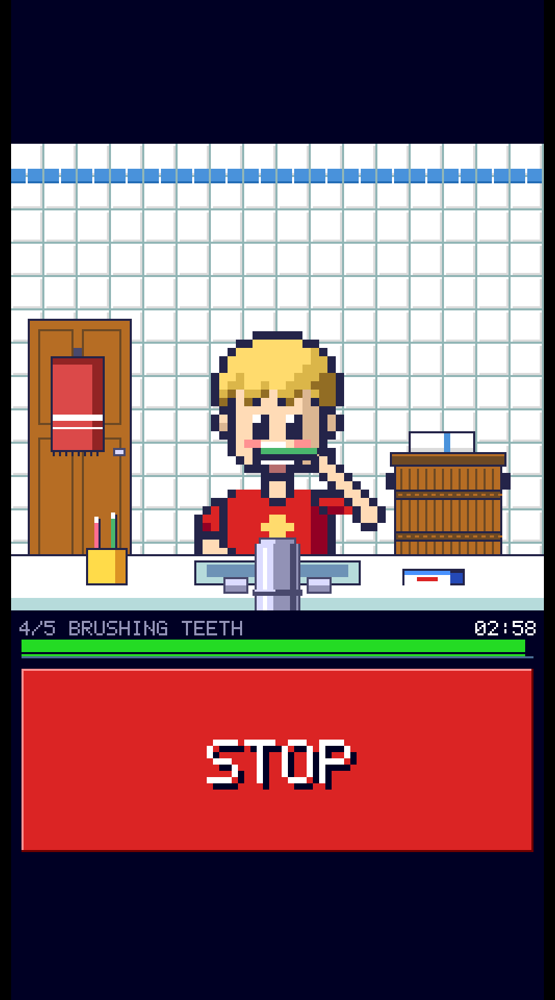 |

| 5. Shoes | Great job! | Game over | All done! |
|:---:|:---:|:---:|:---:|
| 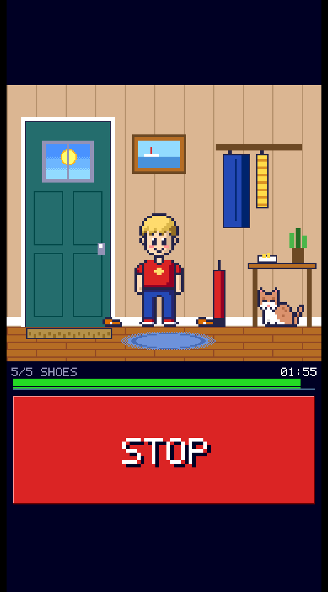 | 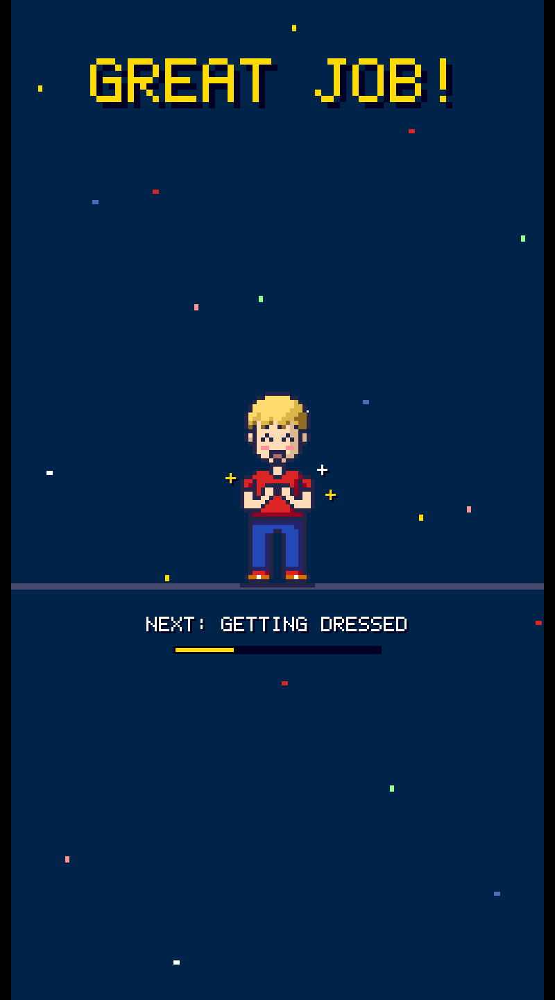 | 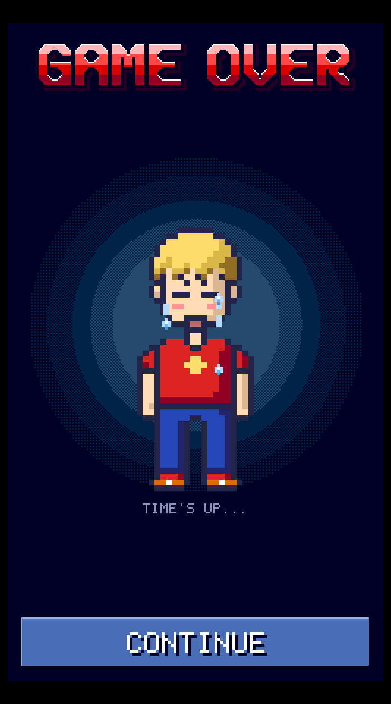 |  |

The windows (bedroom, kitchen, front door) show the **real sky** of the configured town: sun, clouds, rain, snow, dawn, dusk or night, from the free [Open-Meteo](https://open-meteo.com/) API. Offline, sunrise and sunset are computed locally.

## Running it

There is nothing to install or build. Either:

- **Open `index.html`** directly in Chrome, or
- **Serve the folder** over plain HTTP, which is the best option for a phone or tablet on the home network:

  ```sh
  python3 -m http.server 8000
  # then open http://<your-computer-ip>:8000 on the device
  ```

  Any static host works too (GitHub Pages, a NAS, and so on).

### On the kid's device

- Use the device in **portrait** mode.
- **Set the screen timeout as long as possible** (or "never" while the routine runs). Old Android has no way for a web page to keep the screen awake.
- Sound starts after the **first tap** (browser rule). The speaker button on the options screen turns sound on or off.

## Customizing

### Sounds

The sounds are plain files in [`sounds/`](sounds/). **Replace them with your own**: same file name, or change the paths in `src/config.js` (`SOUND.FILES`).

| File | Plays when |
|---|---|
| `sounds/bells.wav` | half of the scene's time is gone |
| `sounds/hurry.wav` | 10% of the time is left |
| `sounds/level-up.wav` | STOP is pressed in time |

WAV or MP3 under ~2 seconds work best on old Android. Try them with `tools/sound-preview.html`. `python3 tools/make-sounds.py` restores the defaults. See [`sounds/README.md`](sounds/README.md).

### Settings (`src/config.js`)

All tunable values live in one file:

- `SCENES`: names, default durations and the French title-card titles
- `STEP_SEC`, `MIN_SEC`, `MAX_SEC`: timer range on the options screen
- `MAX_SPEED`, `SPEED_RAMP_START`: how much the animation speeds up near the end
- `RED_ALERT*`, `RED_PULSE_HZ_*`, `FLASH_HZ`: red alert timing. The pulse is hard-capped at 3 Hz (photosensitivity guideline).
- `SOUND`: on/off default, volume, when the cues play, the sound files
- `WEATHER`: the town (name, latitude, longitude) whose sky appears in the windows
- `SHOW_TEST_BUTTON`: show or hide the TEST MODE button

## Test mode & dev tools

- **TEST MODE** (button on the options screen) jumps to any scene, title card, GREAT JOB, GAME OVER or ALL DONE, with a speed slider. **END OF TIMER** plays the last 10 seconds of a timer, with the speed-up, the red alert and the sounds. You can also force the time of day and the weather.
- URL shortcuts:
  - `index.html?scene=2&sec=20` jumps to scene 3 with a 20 s timer (add `&intro=0` to skip the title card).
  - `?sky=rain&tod=dusk` forces the sky (`clear, partly, overcast, fog, rain, snow, storm` / `night, dawn, day, dusk`).
- `tools/character-preview.html`: every body part, outfit and pose of the kid.
- `tools/scene-strip.html?scene=teeth&t=0,500,1000&red=1`: a filmstrip of one scene.
- `tools/sound-preview.html`: plays each sound.

Before committing, lint for ES5 (a syntax error on the old device means a blank screen):

```sh
npx eslint --no-eslintrc --parser-options=ecmaVersion:5 --env browser "src/**/*.js"
```

To test on the real device, use USB remote debugging (`chrome://inspect` in desktop Chrome).

## Project layout

```
index.html            canvas + script loader (cache-busting, dependency order)
src/config.js         every tunable value
src/palette.js        Mega Drive 9-bit palette, red-alert color mapping
src/font.js           bitmap pixel font + title font
src/sprites.js        sprite format, pre-rendered canvas cache
src/character.js      the kid: one layered rig reused by every scene
src/scenes/*.js       shower, dressing, breakfast, teeth, shoes, end
src/weather.js        live sky data (Open-Meteo, offline fallback)
src/sky.js            draws the sky in the windows
src/lighting.js       time-of-day / weather lighting for the end screen
src/ui.js             buttons, checkbox, dropdown, time bar
src/sound.js          notification sounds (plays the files in sounds/)
src/states.js         state machine: options, title, scene, great job, game over, end
src/testmode.js       test mode
src/main.js           boot, scaling, main loop, touch input
sounds/               the notification sounds (replaceable)
tools/                dev pages and scripts
```

Technical rules for contributors (ES5 only, Chrome 30 APIs, performance, art direction) are in [`CLAUDE.md`](CLAUDE.md).
